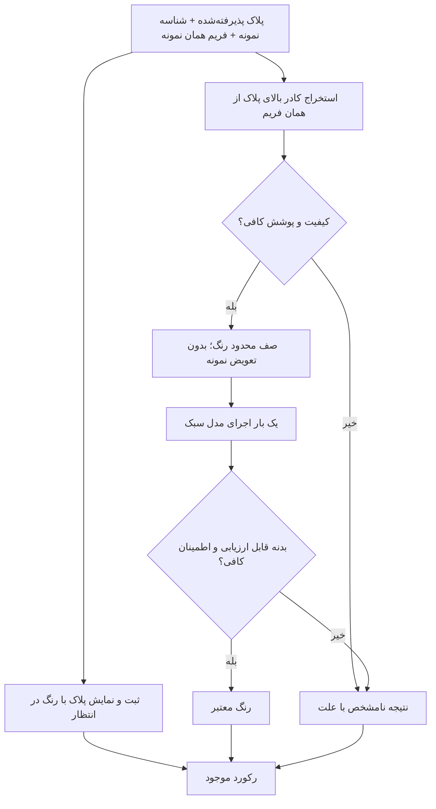

# طرح تشخیص رنگ خودرو از یک فریم

وضعیت: طراحی برای برنامهٔ مستقل Windows؛ worker و به‌روزرسانی رکورد شرح‌داده‌شده در این سند هنوز پیاده‌سازی نشده‌اند. پیاده‌سازی فعلی از مدل آمادهٔ Intel OMZ 0039 روی اولین مشاهدهٔ هر Track استفاده می‌کند؛ این سند مسیر جداگانهٔ مدل سبک روی نمونهٔ OCR موفق را طراحی می‌کند. این سند قرارداد جایگزین آن است، نه شرح رفتار نسخهٔ فعلی.

## تصمیم‌های قطعی

- ورودی فقط همان فریم اصلیِ نمونه‌ای است که تشخیص نهایی پلاک از آن ساخته می‌شود؛ دریافت فریم جدید، انتخاب بهترین فریم از چند تصویر، رأی‌گیری و تلاش مجدد رنگ ممنوع است.
- کادر رنگ به‌صورت پیش‌فرض هم‌عرض کادر اصلی detector پلاک، با ارتفاع سه برابر ارتفاع آن و بلافاصله بالای پلاک است. مدل تشخیص خودرو اضافه نمی‌شود.
- برای هر شناسهٔ نمونهٔ تشخیص، حداکثر یک فراخوانی مدل رنگ مجاز است. اگر پیش‌بررسی شکست بخورد، تعداد فراخوانی صفر است.
- رنگ اطلاعات تکمیلی است. پذیرش، ثبت، نمایش و ارسال اولیهٔ پلاک به تکمیل رنگ وابسته نیست.
- نتیجهٔ رنگ به همان رکورد موجود افزوده می‌شود؛ رویداد جدیدِ تشخیص پلاک و کارت تکراری ایجاد نمی‌کند.
- خروجی نهایی رنگ یا یک گروه رنگ معتبر است یا «نامشخص». برآورد کم‌اطمینان به‌عنوان رنگ خودرو نمایش داده نمی‌شود.

## مسیر پردازش



این دو شاخه استقلال منطقی دارند؛ ثبت نتیجهٔ رنگ نباید به ترتیب پایان OCR، ذخیرهٔ رکورد یا پایان مدل وابسته باشد. نمونه قبل از آزادشدن فریم کپی می‌شود، اما مدل بیرون مسیر بحرانی پردازش دوربین اجرا می‌شود.

### انتخاب دقیق نمونه

| مسیر | فریم مورد استفاده | زمان آغاز رنگ |
| --- | --- | --- |
| Inline | فریم اصلی متناظر با نتیجهٔ پذیرفته‌شدهٔ OCR | پس از پذیرش پلاک، با استخراج crop پیش از آزادسازی فریم |
| TrackAndQueue | snapshot همان آیتم صف که OCR آن به نتیجهٔ معتبر رسیده است | پس از موفقیت OCR، پیش از آزادسازی snapshot آن آیتم |

تلاش‌های OCR ناموفق یا نمونه‌های جایگزین‌شده، inference رنگ ایجاد نمی‌کنند. تلاش مجدد OCR مطابق تنظیمات خودش ممکن است ادامه یابد؛ رنگ فقط روی نمونهٔ موفق اجرا می‌شود. crop پلاکِ OCR برای رنگ کافی نیست؛ کادر رنگ از snapshot اصلی همراه همان نمونه استخراج می‌شود. استفاده از آخرین تصویر دوربین مجاز نیست.

دامنهٔ اجرای یک‌باره «نمونهٔ تشخیص منتشرشده» است، نه متن پلاک. دو عبور مستقل با شمارهٔ یکسان می‌توانند دو نتیجهٔ رنگ مستقل داشته باشند. بازنشر یا تحویل تکراری همان نمونه نباید اجرای دوباره ایجاد کند. در حالت detector-only که شمارهٔ پلاک تکمیل نمی‌شود، این طرح درخواست رنگِ وابسته به تشخیص نهایی ایجاد نمی‌کند.

## هندسه و کیفیت ورودی

برای کادر اصلی پلاک `(x,y,w,h)` در مختصات فریم اصلی:

```text
ColorBounds = (x, y - 3*h, w, 3*h)
```

`PlateDetectorBounds` مبناست؛ padding و صاف‌کردن تصویر برای OCR در این هندسه وارد نمی‌شوند. تصویر ورودی رنگ باید BGR اصلی باشد، نه تصویر خاکستری، ماسک Motion یا ROI سیاه‌شده. کادر می‌تواند بیرون ROI پلاک باشد، ولی فقط پیکسل‌های موجود در فریم اصلی استفاده می‌شوند.

برش خارج تصویر clip می‌شود. پوشش کمتر از آستانه، اندازهٔ ناکافی یا قالب نامعتبر، بدون فراخوانی مدل به Unknown می‌رسد. کنترل تاریکی، اشباع و تاری باید محافظه‌کارانه و با دادهٔ واقعی تنظیم شود؛ تیره‌بودن به‌تنهایی دلیل رد نیست، چون خودروی مشکی معتبر است. تصویر IR/تک‌رنگ فاقد اطلاعات کافی رنگ واقعی است؛ در دوربین دارای حالت اعلام‌شدهٔ IR، خروجی Unknown است و مدل اجرا نمی‌شود. تشخیص خودکار IR جزء این نسخه نیست.

مقادیر عرض، ارتفاع و فاصلهٔ موجود برای تنظیم هر دوربین حفظ می‌شوند، با پیش‌فرض `1، 3، 0`. تغییر محسوس هندسه نسبت به دادهٔ آموزش باید دوباره ارزیابی شود. UI کادر دقیق مصرف‌شده را نمایش می‌دهد.

## مدل و قرارداد خروجی

گزینهٔ اولیه برای آزمایش، classifier سبک از خانوادهٔ MobileNetV3-Small با خروجی ONNX است؛ انتخاب نهایی معماری و اندازهٔ ورودی پس از ارزیابی انجام می‌شود. این نام به معنی وجود وزن آموزش‌دیدهٔ قابل‌استفاده در پروژه نیست.

مدل باید روی برش‌های بالای پلاک آموزش/تنظیم شود. استفادهٔ مستقیم از وزن ImageNet یا مدل آموزش‌دیده فقط روی تصویر کامل خودرو، معیار تحویل را برآورده نمی‌کند.

گروه‌های اولیه: White، Black، SilverGray، Red، Blue، Green، Yellow، Orange، Brown، Beige، Purple و Unusable. نقره‌ای/خاکستری فعلاً یک گروه است. کلاس Unusable شامل برش غالباً شیشه، جلوپنجره، پس‌زمینه، تصویر فاقد بدنهٔ کافی یا کیفیت غیرقابل‌ارزیابی است. یک کلاس به‌تنهایی تشخیص همهٔ ورودی‌های نامناسب را تضمین نمی‌کند؛ آستانهٔ پذیرش نیز لازم است.

manifest مدل باید نسخه، ترتیب برچسب‌ها، نام و شکل tensorها، RGB/BGR، روش resize/letterbox، normalization و نوع خروجی logits/probabilities را تعیین کند. پردازش ورودی باید دقیقاً با آموزش یکسان باشد. softmax فقط برای logits اعمال می‌شود. کلاس خروجی و تعداد آن باید با manifest تطبیق داده شود؛ عدم تطابق، خطای مدل است و نباید به حدس رنگ منجر شود.

پذیرش مستلزم همهٔ موارد زیر است:

1. کلاس اول یک رنگ باشد، نه Unusable.
2. امتیاز کلاس اول از آستانهٔ پذیرش بیشتر یا مساوی باشد.
3. فاصلهٔ امتیاز کلاس اول و دوم، با احتساب Unusable، از حداقل فاصلهٔ تنظیم‌شده کمتر نباشد.

آستانه‌ها روی مجموعهٔ اعتبارسنجی انتخاب می‌شوند؛ عدد قطعی قبل از آموزش تعیین نمی‌شود. خروجی softmax لزوماً احتمال کالیبره‌شده نیست و UI آن را «امتیاز مدل» می‌نامد. نتیجهٔ کم‌اطمینان، Unknown با دلیل LowConfidence یا AmbiguousColor خواهد بود. Lab به‌عنوان fallback برای حدس‌زدن رنگ اجرا نمی‌شود.

## اجرای مستقل و محدودیت منابع

- worker رنگ جدا از worker تکمیل Face/Plate است؛ OCR منتظر آزادشدن آن نمی‌ماند.
- یک صف محدود اختصاصی رنگ برای هر دوربین وجود دارد؛ ظرفیت و حافظهٔ آن از بافر Face/Plate مستقل است. زمان‌بندی بین دوربین‌ها منصفانه و concurrency کل برنامه محدود است.
- پیش‌فرض اجرایی پیشنهادی برای شروع benchmark: یک inference هم‌زمان در کل برنامه، یک thread برای مدل و حداکثر ۱۶ کار منتظر برای هر دوربین. این‌ها هدف کارایی تأییدشده نیستند؛ همراه سقف حافظهٔ صریح اعمال می‌شوند.
- تنها crop لازم به شکل ورودی مدل و اطلاعات اتصال به رکورد نگه داشته شود؛ برای رنگ full-frame جدیدی در صف ذخیره نشود. تمام حافظه و کارهای در حال اجرا در سقف بودجه حساب شوند.
- ظرفیت پر یا بودجهٔ حافظهٔ ناکافی: Unknown/QueueFull یا MemoryLimit؛ capture و ثبت پلاک مسدود نمی‌شوند. نمونهٔ تازه جایگزین قبلی نمی‌شود.
- deadline از لحظهٔ ایجاد درخواست محاسبه می‌شود و انتظار صف را هم شامل می‌شود. مقدار آغازین پیشنهادی ۲۰۰۰ میلی‌ثانیه است و باید با اندازه‌گیری تنظیم شود. نتیجهٔ دیرهنگام پس از TimedOut اعمال نمی‌شود؛ منابع inference جاری تا پایان/لغو واقعی همچنان در حساب بودجه می‌مانند.
- خطای مدل، timeout یا ورودی نامعتبر تلاش مجدد ندارد. failure مستقل رنگ در log ثبت می‌شود و pipeline پلاک ادامه پیدا می‌کند.

## هویت، وضعیت و ذخیره‌سازی

شناسهٔ مستقل و پایدار `RecognitionSampleId` قبل از انتشار تشخیص ساخته و از runtime تا کارت و Event Store حمل می‌شود. کلید درخواست شامل CameraId، session/epoch، RoiId، ProcessingId و RecognitionSampleId است. TrackId صرفاً اطلاعات کمکی است؛ متن پلاک و TrackId به‌تنهایی کلید به‌روزرسانی نیستند.

وضعیت‌ها:

```text
Disabled
Pending -> Accepted
Pending -> Unknown
Pending -> Failed
Pending -> TimedOut
Pending -> Cancelled
```

همهٔ وضعیت‌ها به‌جز Pending نهایی‌اند. صف/ورودی نامعتبر می‌تواند مستقیم نتیجهٔ نهایی تولید کند. وضعیت Sampling، رأی‌گیری، MinimumSamples و candidate تأییدنشده در مسیر جدید وجود ندارند. UI برای Failed/TimedOut/Cancelled نیز رنگ را «نامشخص» و علت را در جزئیات نمایش می‌دهد.

فیلدهای پیشنهادی نتیجه: RecognitionSampleId، RequestId، State، Color، ModelScore، Reason، ModelId، ModelVersion، SettingsRevision، SourceFrameId، SourceTimestamp، SampleBounds، RegionCoverage، InferenceMs و CompletedAt. مقدار Color فقط در Accepted پر می‌شود. زمان فریم از زمان تکمیل رنگ مستقل است.

به‌روزرسانی ذخیره‌سازی اتمی و idempotent است: فقط درخواست Pending با همان RequestId به نتیجهٔ نهایی منتقل شود. اگر نتیجه قبل از ذخیرهٔ پلاک برسد، یک محل موقت محدود با TTL آن را تا ایجاد رکورد نگه می‌دارد. حذف رکورد توسط کاربر، آن را دوباره ایجاد نمی‌کند. اگر سیاست history اجازهٔ ذخیره ندهد، نتیجه فقط روی کارت/نمایش موجود اعمال می‌شود و رکورد اجباری نمی‌سازد.

رخداد ترکیبی PlateFace باید RecognitionSampleId جزء پلاک را حفظ کند و enrichment به همان جزء برسد؛ metadata Face تغییر نکند. نگاشت نمونه به رکوردهای ذخیره‌شده باید بدون جست‌وجو بر اساس شمارهٔ پلاک انجام شود. تاریخچه پس از بستن/بازکردن برنامه نتیجهٔ نهایی را بازخوانی کند. Pending باقی‌مانده از اجرای قبلی به Cancelled/Interrupted تبدیل شود؛ مدل دوباره اجرا نشود.

توقف دوربین، reconnect یا تغییر تنظیمات، درخواست‌های Pending نسل قبلی را Cancelled می‌کند. نتیجهٔ دیرهنگام آن نسل روی رکورد جدید یا overlay جدید اعمال نمی‌شود. لغو هرگز رکورد اصلی پلاک را حذف نمی‌کند.

## رابط Windows و تنظیمات

محل: تنظیمات دوربین ← ROI ← پردازش Plate ← تنظیمات رنگ خودرو. این قابلیت به‌صورت مکمل همان task باقی می‌ماند و مقصد recognition یا تعریف OCR جدید نمی‌خواهد.

کنترل‌های قابل‌نمایش:

| کنترل | رفتار |
| --- | --- |
| فعال‌سازی رنگ | مستقل از OCR و جهت |
| مدل رنگ | انتخاب package معتبر از catalog، با نمایش نسخه و وضعیت آماده‌بودن |
| آستانهٔ پذیرش و حداقل فاصلهٔ دو رنگ | محدودهٔ ۰ تا ۱، مقدار اولیه از manifest تأییدشده |
| عرض/ارتفاع/فاصلهٔ کادر | پیش‌فرض ۱/۳/۰ و نمایش کادر نمونه |
| شیوهٔ اجرا | متن ثابت «یک فریم، یک‌بار برای هر تشخیص» |
| تنظیمات پیشرفته | ظرفیت صف رنگ، سقف حافظه و deadline؛ در سطح دوربین |

تنظیمات MinimumSamples، MaximumAttempts، SampleIntervalMs، MinimumAgreement و MaximumLabDistance در این مسیر نشان داده نمی‌شوند. تعداد worker و thread محدودیت کل برنامه است و در هر ROI تکثیر نمی‌شود.

کارت تشخیص ابتدا «رنگ: در انتظار» نشان می‌دهد؛ همان کارت سپس به «مشکی» یا «نامشخص» تغییر می‌کند. حالت انتظار به‌عنوان نام رنگ نمایش داده نمی‌شود. جزئیات، علت عدم نتیجه و امتیاز مدل را نشان می‌دهد. بازخوانی فرم و کپی task باید همهٔ تنظیمات جدید را حفظ کنند.

تنظیمات جدید نسخه‌دار است. حالت فعلی Lab در تنظیمات قدیمی قابل‌شناسایی می‌ماند؛ انتخاب آگاهانهٔ مدل جدید لازم است و بدون مدل معتبر مهاجرت خودکار انجام نمی‌شود. در مسیر جدید، خرابی یا نبود مدل هرگز fallback مخفی به Lab ایجاد نمی‌کند. فعال‌نبودن مدل رنگ مانع ذخیرهٔ تنظیمات اصلی یا اجرای پلاک نمی‌شود؛ UI خطای اختصاصی رنگ را روشن نمایش می‌دهد.

## انتشار و automation

رویداد اولیهٔ Plate فوراً منتشر می‌شود و ممکن است ColorState=Pending داشته باشد. تکمیل رنگ فقط notification داخلی مستقلِ به‌روزرسانی مشخصات را برای UI و persistence تولید می‌کند؛ triggerهای تشخیص پلاک، گیت و webhook اولیه دوباره اجرا نمی‌شوند.

این نسخه ارسال پیام دوم خارجی را خودکار اضافه نمی‌کند. مصرف‌کننده‌ای که فقط رویداد اولیه را دریافت می‌کند ممکن است رنگ نهایی را نداشته باشد. در صورت نیاز آینده، قرارداد opt-in مستقل برای AttributesUpdated با شناسهٔ همان رویداد طراحی می‌شود؛ این موضوع نباید با تأخیر انداختن رویداد اولیه حل شود.

## داده، آموزش و ارزیابی

نمونه‌ها باید دقیقاً با هندسهٔ runtime از دوربین‌های هدف تهیه شوند. برچسب رنگ از مشاهدهٔ قابل‌اعتماد بدنهٔ خودرو تعیین شود؛ اگر رنگ از این برش قابل استنباط نیست، برش Unusable است، حتی اگر رنگ خودرو از تصویر کامل معلوم باشد.

داده شامل مشکی، خاکستری تیره، سرمه‌ای، بازتاب، سایه، نور روز/شب رنگی و قطعات غیر بدنه باشد. تقسیم train/validation/test بر اساس عبور/خودرو و بازهٔ ضبط یا دوربین انجام شود تا تصاویر نزدیک یک خودرو بین مجموعه‌ها نشت نکنند. augmentation رنگی نباید بدون تغییر برچسب، رنگ اصلی را عوض کند. تعداد دادهٔ کافی با منحنی یادگیری و نتیجهٔ test تعیین می‌شود، نه یک عدد تضمینی از قبل.

آموزش بیرون runtime است. خروجی تأییدشده باید همراه manifest و نسخه با سازوکار موجود `.hshmodel` بسته‌بندی شود؛ مسیر Windows مدل خام یا دانلود خودکار ندارد. برای رنگ مکمل Plate، سازگاری با feature Plate در loader موجود بررسی و پیاده‌سازی شود؛ این طرح لایسنس مستقل جدیدی تعریف نمی‌کند.

ارزیابی پیش از جایگزینی شامل precision هر رنگ، confusion matrix مخصوص مشکی/خاکستری/سرمه‌ای، نرخ Unknown و پوشش نتایج پذیرفته‌شده است. روش Lab و مدل جدید روی یک مجموعهٔ تک‌فریم ثابت مقایسه شوند. بهبود accuracy با اعلام Unknown برای تقریباً همهٔ موارد موفقیت محسوب نمی‌شود. حداقل precision/پوشش قابل‌قبول بعد از گزارش خط پایه مشخص می‌شود؛ این سند درصد دقت تضمین نمی‌کند.

کارایی روی سیستم هدف با زمان crop/preprocess/inference/update، تأخیر p50/p95، CPU، حافظه، queue overflow و تأثیر روی FPS/OCR اندازه‌گیری شود؛ آزمایش یک دوربین و چند دوربین لازم است. کاهش اندازه یا quantization فقط پس از مقایسهٔ دوبارهٔ دقت مجاز است.

## معیارهای پذیرش پیاده‌سازی

1. در Inline و TrackAndQueue و هر دو حالت Sequential/Parallel، فریم و هندسهٔ رنگ دقیقاً متعلق به نمونهٔ نهایی پلاک باشد؛ تغییر فریم زنده اثری نداشته باشد.
2. برای هر RecognitionSampleId شمارندهٔ inference صفر یا یک باشد؛ فریم‌های بعدی، callback تکراری و بازکردن تاریخچه آن را افزایش ندهند.
3. با مدل کند، خراب، غایب، صف پر و timeout، پلاک همچنان منتشر و ثبت شود.
4. نتیجهٔ قبل/بعد از ذخیرهٔ رکورد درست اعمال شود؛ کارت و رکورد تکراری ساخته نشود و پلاک‌های هم‌شماره در دو عبور مخلوط نشوند.
5. نتیجهٔ دیرهنگام پس از حذف، توقف، reconnect یا تغییر نسل، رکورد حذف‌شده را احیا نکند و به نمونهٔ دیگر نرسد.
6. رنگ رکورد و جزء پلاک در association پس از restart یکسان بازخوانی شود؛ Pending قدیمی پایدار نماند و trigger اولیه دوباره اجرا نشود.
7. Unusable، امتیاز ناکافی، برش ناقص و IR اعلام‌شده رنگ قطعی تولید نکنند؛ خودرو مشکی صرفاً به دلیل تیرگی حذف نشود.
8. تنظیمات و catalog مدل در فارسی/انگلیسی، ذخیره/ویرایش/کپی task و فایل‌های قدیمی بررسی شوند.
9. گزارش مستقل دقت تک‌فریم و هزینهٔ CPU روی داده و سخت‌افزار هدف پیش از فعال‌سازی عمومی موجود باشد.

## ترتیب اجرا

ابتدا قرارداد نمونه/به‌روزرسانی و آزمون استقلال پلاک با مدل جعلی پیاده شود. هم‌زمان یا پس از آن دادهٔ برش‌ها تهیه، مدل آموزش و ارزیابی شود. سپس loader/manifest، worker محدود، اتصال UI/persistence و migration تکمیل شوند. فعال‌سازی نهایی پس از تحویل مدل معتبر و عبور از آزمون‌های عملکردی و ارزیابی واقعی انجام می‌شود. صرف آماده‌شدن کد بدون وزن آموزش‌دیده، تحویل قابلیت تشخیص رنگ محسوب نمی‌شود.
